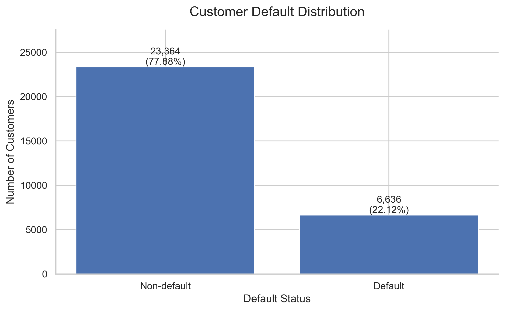
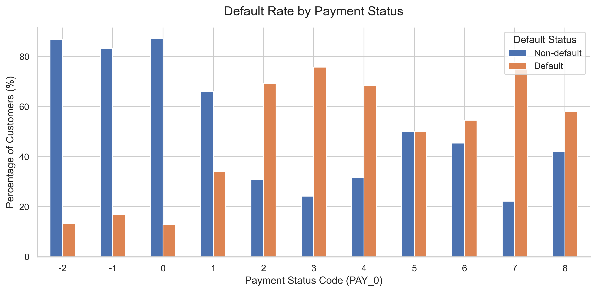
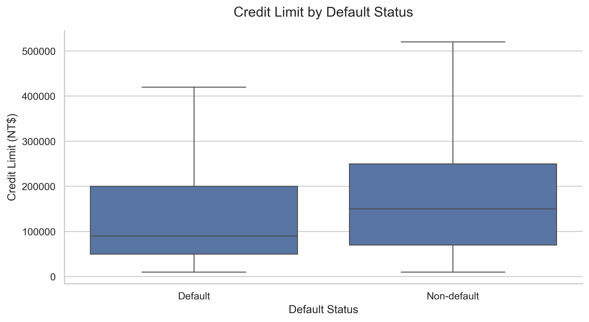
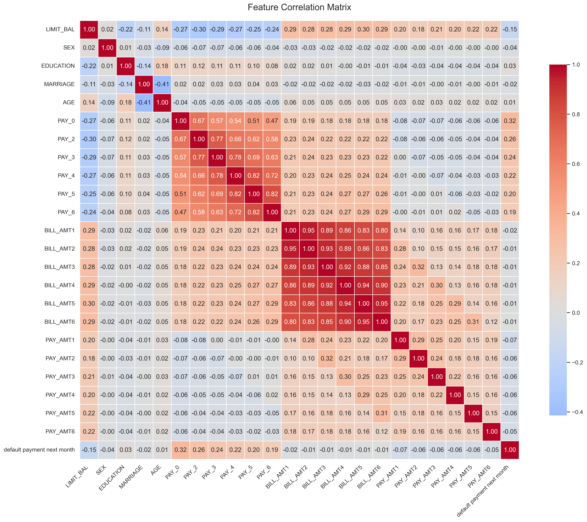
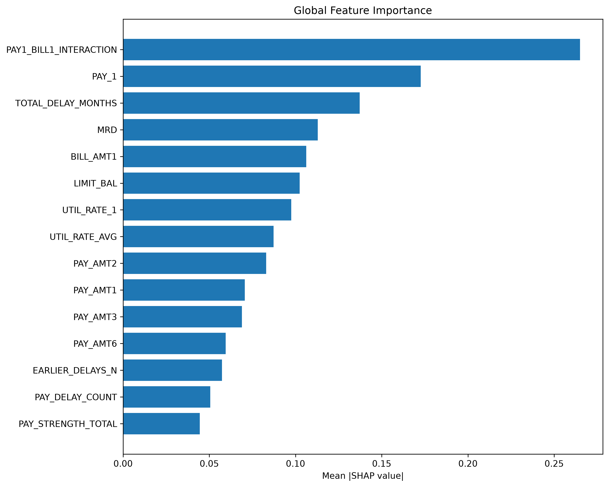
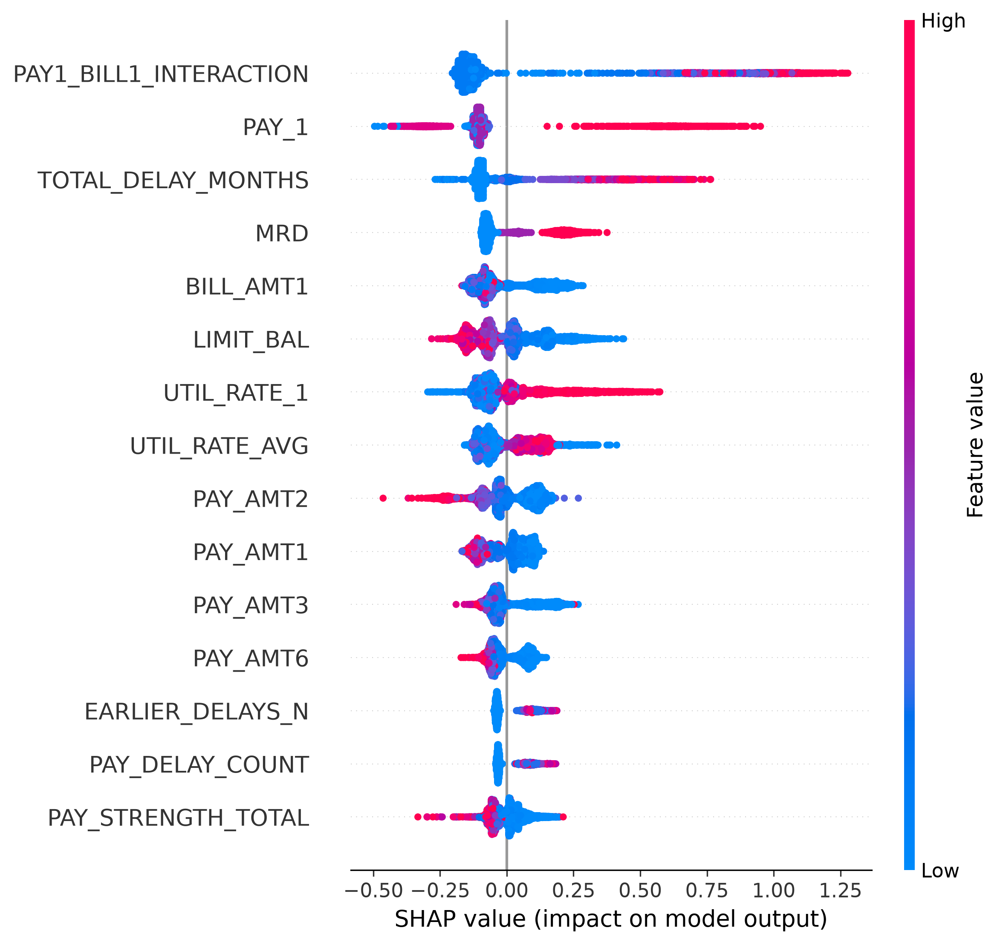
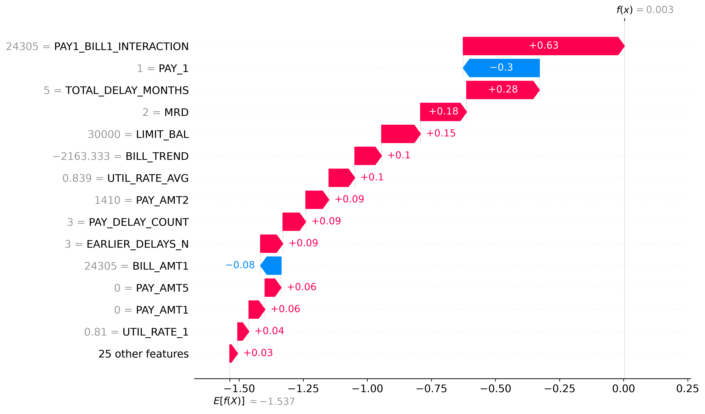

# Credit Risk Intelligence
### Credit Default Prediction & Explainable Machine Learning

<p align="center">
  
  
  
  
</p>

## 1. Executive Summary

**A machine learning approach to estimate credit default probability and understand the factors influencing individual risk predictions.**

This project presents an end-to-end credit risk modeling workflow using the UCI Default of Credit Card Clients dataset.

A tuned **Gradient Boosting Classifier** was developed to estimate the probability of credit default. The workflow combines exploratory data analysis, feature engineering, model optimization, cross-validation, and SHAP explainability.

The selected model achieved a **ROC-AUC of 0.788**, with payment behavior and delinquency-related variables emerging as important contributors to its predictions.

The objective is to demonstrate how machine learning can support credit risk analysis while providing interpretable insights, rather than automating credit approval decisions.

## 2. Exploratory Data Analysis

The exploratory analysis focused on understanding the target distribution, identifying default patterns, and examining relationships between payment behavior and credit characteristics.

### Target Distribution

The target variable indicates whether a customer defaulted on their payment in the following month. The dataset has an approximate default rate of **22.12%**, showing an imbalance between the two classes.

<p align="center">
  
</p>

### Payment Behavior and Credit Characteristics

Payment status was analyzed to identify differences between customers with and without default. Credit limits were also explored to understand how credit characteristics varied across both groups.

<table>
  <tr>
    <td width="50%" align="center">
      
      <br><em>Payment status by default.</em>
    </td>
    <td width="50%" align="center">
      
      <br><em>Credit limit distribution by default status.</em>
    </td>
  </tr>
</table>

### Feature Correlations

A correlation matrix was used to explore relationships between numerical variables and identify potential dependencies within the dataset.

<p align="center">
  
</p>

## 3. Feature Engineering & Model Development

Additional features were created to capture credit behavior patterns that may not be fully represented by the original variables.

Key engineered features included:

- **Delinquency indicators:** number and severity of payment delays.
- **Credit utilization:** ratios comparing outstanding balances with credit limits.
- **Payment behavior:** payment-to-bill ratios and historical payment patterns.
- **Financial trends:** changes in billing amounts and payments over time.
- **Interaction features:** combinations of payment status and billing information.

Several modeling alternatives were evaluated before selecting a tuned Gradient Boosting Classifier.

## 4. Model Performance

The selected model was optimized using RandomizedSearchCV and evaluated through stratified 5-fold cross-validation.

| Metric | Cross-validation result |
|:---|---:|
| ROC-AUC | **0.788** |
| Average Precision | **0.562** |
| KS Statistic | **0.437** |
| Validation | 5-fold stratified CV |

These results correspond to pooled out-of-fold estimates and provide an indication of the model's ability to distinguish between default and non-default cases.

## 5. Explainable AI — SHAP

SHAP was incorporated to understand which variables influenced model predictions and how their contributions varied across customers.

### Global Feature Importance

Payment behavior and delinquency-related features were among the most influential variables in the model.

<p align="center">
  
</p>

### SHAP Summary

The summary plot illustrates how different feature values contribute to increasing or decreasing the model's output across evaluated observations.

<p align="center">
  
</p>

### Individual Prediction Explanation

A waterfall plot was used to examine an individual prediction, showing how different features contributed positively or negatively to the model's output.

<p align="center">
  
</p>

## 6. Technology Stack

- **Programming:** Python
- **Data Analysis:** Pandas, NumPy
- **Machine Learning:** Scikit-learn
- **Explainability:** SHAP
- **Visualization:** Matplotlib, Seaborn
- **Model Persistence:** Joblib
- **Environment:** Jupyter Notebook

## 7. Repository Structure

```text
Credit-Risk-Intelligence/
│
├── notebooks/
│   ├── 01_data_exploration.ipynb
│   ├── 02_baseline_modeling.ipynb
│   ├── 03_preprocessing_feature_engineering.ipynb
│   └── 04_model_explainability.ipynb
│
├── src/
│   └── feature_engineering.py
│
├── data/
│   └── processed/
│
├── models/
│   └── credit_risk_pipeline_v1.joblib
│
├── images/
│   ├── target_distribution.png
│   ├── payment_status_by_default.png
│   ├── credit_limit_by_default.png
│   ├── correlation_matrix.png
│   ├── shap_global_importance.png
│   ├── shap_summary.png
│   └── shap_individual_waterfall.png
│
└── README.md
```

## 8. Dataset & Limitations

**Dataset:** [UCI — Default of Credit Card Clients](https://archive.ics.uci.edu/dataset/350/default+of+credit+card+clients)

The dataset contains historical credit card client information from Taiwan. Its results should not be assumed to generalize to current customers or other markets.

The test set was used during model comparison and is therefore not an independent final holdout. SHAP values explain model behavior and associations, not causal relationships.

**This project is intended for educational and portfolio purposes. It is not designed for real-world credit approval decisions.**

---

# Credit Risk Intelligence
### Predicción de Incumplimiento Crediticio y Machine Learning Explicable

## 1. Resumen Ejecutivo

**Un enfoque de machine learning para estimar la probabilidad de incumplimiento crediticio y comprender los factores que influyen en las predicciones individuales de riesgo.**

Este proyecto presenta un flujo de trabajo integral de modelamiento de riesgo crediticio utilizando el dataset UCI Default of Credit Card Clients.

Se desarrolló un modelo **Gradient Boosting Classifier** optimizado para estimar la probabilidad de incumplimiento crediticio. El flujo combina análisis exploratorio, ingeniería de características, optimización del modelo, validación cruzada y explicabilidad mediante SHAP.

El modelo seleccionado obtuvo un **ROC-AUC de 0.788**, destacando el comportamiento de pago y las variables relacionadas con morosidad entre los principales factores que contribuyen a sus predicciones.

El objetivo es demostrar cómo el machine learning puede apoyar el análisis de riesgo crediticio y entregar información interpretable, en lugar de automatizar decisiones de aprobación crediticia.

## 2. Análisis Exploratorio de Datos

El análisis exploratorio se enfocó en comprender la distribución de la variable objetivo, identificar patrones de incumplimiento y examinar las relaciones entre el comportamiento de pago y las características crediticias.

### Distribución de la Variable Objetivo

La variable objetivo indica si un cliente incumplió el pago durante el mes siguiente. El dataset presenta una tasa de incumplimiento aproximada del **22.12%**, evidenciando un desbalance entre ambas clases.

<p align="center">
  
</p>

### Comportamiento de Pago y Características Crediticias

Se analizó el estado de pago para identificar diferencias entre clientes con y sin incumplimiento. También se exploraron los límites de crédito para comprender cómo variaban las características crediticias entre ambos grupos.

<table>
  <tr>
    <td width="50%" align="center">
      
      <br><em>Estado de pago según incumplimiento.</em>
    </td>
    <td width="50%" align="center">
      
      <br><em>Distribución del límite de crédito según incumplimiento.</em>
    </td>
  </tr>
</table>

### Correlación entre Variables

Se utilizó una matriz de correlación para explorar las relaciones entre variables numéricas e identificar posibles dependencias dentro del dataset.

<p align="center">
  
</p>

## 3. Ingeniería de Características y Desarrollo del Modelo

Se construyeron nuevas variables para capturar patrones de comportamiento crediticio que no estaban completamente representados en las variables originales.

Entre las principales características creadas se encuentran:

- **Indicadores de morosidad:** cantidad y severidad de los retrasos en los pagos.
- **Utilización del crédito:** ratios que comparan los saldos pendientes con los límites de crédito.
- **Comportamiento de pago:** ratios entre pagos y facturación, además de patrones históricos.
- **Tendencias financieras:** cambios en los montos facturados y pagos a lo largo del tiempo.
- **Variables de interacción:** combinaciones entre el estado de pago y la información de facturación.

Se evaluaron distintas alternativas de modelamiento antes de seleccionar un Gradient Boosting Classifier optimizado.

## 4. Resultados del Modelo

El modelo seleccionado fue optimizado mediante RandomizedSearchCV y evaluado utilizando validación cruzada estratificada de 5 folds.

| Métrica | Resultado de validación cruzada |
|:---|---:|
| ROC-AUC | **0.788** |
| Average Precision | **0.562** |
| Estadístico KS | **0.437** |
| Validación | 5-fold estratificada |

Estos resultados corresponden a estimaciones agrupadas out-of-fold y entregan una referencia de la capacidad del modelo para distinguir entre clientes con y sin incumplimiento.

## 5. Inteligencia Artificial Explicable — SHAP

Se incorporó SHAP para comprender qué variables influyen en las predicciones del modelo y cómo varían sus contribuciones entre clientes.

### Importancia Global de Variables

El comportamiento de pago y las variables relacionadas con morosidad estuvieron entre las características más influyentes del modelo.

<p align="center">
  
</p>

### Resumen SHAP

El gráfico muestra cómo los distintos valores de las variables contribuyen a aumentar o disminuir la salida del modelo en las observaciones evaluadas.

<p align="center">
  
</p>

### Explicación de una Predicción Individual

Se utilizó un gráfico waterfall para examinar una predicción individual, mostrando cómo distintas variables contribuyeron positiva o negativamente a la salida del modelo.

<p align="center">
  
</p>

## 6. Tecnologías Utilizadas

- **Programación:** Python
- **Análisis de Datos:** Pandas, NumPy
- **Machine Learning:** Scikit-learn
- **Explicabilidad:** SHAP
- **Visualización:** Matplotlib, Seaborn
- **Persistencia del Modelo:** Joblib
- **Entorno de Desarrollo:** Jupyter Notebook

## 7. Estructura del Repositorio

```text
Credit-Risk-Intelligence/
│
├── notebooks/
│   ├── 01_data_exploration.ipynb
│   ├── 02_baseline_modeling.ipynb
│   ├── 03_preprocessing_feature_engineering.ipynb
│   └── 04_model_explainability.ipynb
│
├── src/
│   └── feature_engineering.py
│
├── data/
│   └── processed/
│
├── models/
│   └── credit_risk_pipeline_v1.joblib
│
├── images/
│   ├── target_distribution.png
│   ├── payment_status_by_default.png
│   ├── credit_limit_by_default.png
│   ├── correlation_matrix.png
│   ├── shap_global_importance.png
│   ├── shap_summary.png
│   └── shap_individual_waterfall.png
│
└── README.md
```

## 8. Dataset y Limitaciones

**Dataset:** [UCI — Default of Credit Card Clients](https://archive.ics.uci.edu/dataset/350/default+of+credit+card+clients)

El dataset contiene información histórica de clientes de tarjetas de crédito de Taiwán. Sus resultados no deben extrapolarse automáticamente a clientes actuales ni a otros mercados.

El conjunto de prueba fue utilizado durante la comparación de modelos, por lo que no constituye un holdout final independiente. Los valores SHAP explican el comportamiento y las asociaciones del modelo, no relaciones causales.

**Este proyecto tiene fines educativos y de portafolio. No está diseñado para tomar decisiones reales de aprobación crediticia.**
